<a href="README.md">English</a> · <a href="README.es.md">Español</a> · <b>Català</b>

<picture><source media="(max-width: 640px)" srcset="assets/m/header-ca.svg"></picture>

<a href="https://kakuregalearn.com"><picture><source media="(max-width: 640px)" srcset="assets/m/kakurega-ca.svg"></picture></a>

<b>Kakurega</b> · Com està fet

<picture><source media="(max-width: 640px)" srcset="assets/m/kakurega-arch-ca.svg"></picture>

<a href="https://www.youtube.com/@BlunderLing"><picture><source media="(max-width: 640px)" srcset="assets/m/blunderling-ca.svg"></picture></a>

<b>BlunderLing</b> · Com està fet

<picture><source media="(max-width: 640px)" srcset="assets/m/blunderling-arch-ca.svg"></picture>

<picture><source media="(max-width: 640px)" srcset="assets/m/agents-ca.svg"></picture>

<b>Template_Agents</b> · Com està fet

<picture><source media="(max-width: 640px)" srcset="assets/m/agents-arch-ca.svg"></picture>

<a href="https://wavesbyling.com"><picture><source media="(max-width: 640px)" srcset="assets/m/wavesling-ca.svg"></picture></a>

<b>WavesLing</b> · Com està fet

<picture><source media="(max-width: 640px)" srcset="assets/m/wavesling-arch-ca.svg"></picture>

<a href="https://www.linkedin.com/in/brunomonrealpujol"><picture><source media="(max-width: 640px)" srcset="assets/m/contact-ca.svg"></picture></a>
