

  
  
  

<picture><source media="(max-width: 640px)" srcset="assets/m/cover-en.svg"></picture>

<picture><source media="(max-width: 640px)" srcset="assets/m/letter-en.svg"></picture>

<a href="https://kakuregalearn.com"><picture><source media="(max-width: 640px)" srcset="assets/m/kakurega-1-en.svg"></picture></a>

<a href="https://kakuregalearn.com"><picture><source media="(max-width: 640px)" srcset="assets/m/kakurega-2-en.svg">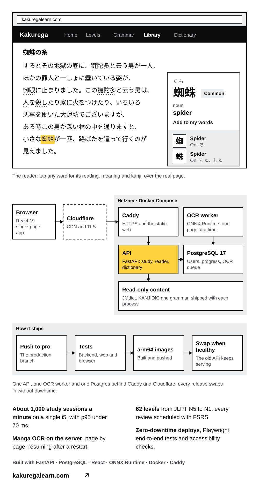</picture></a>

<a href="https://www.youtube.com/@BlunderLing"><picture><source media="(max-width: 640px)" srcset="assets/m/blunderling-1-en.svg"></picture></a>

<a href="https://www.youtube.com/@BlunderLing"><picture><source media="(max-width: 640px)" srcset="assets/m/blunderling-2-en.svg"></picture></a>

<picture><source media="(max-width: 640px)" srcset="assets/m/agents-1-en.svg">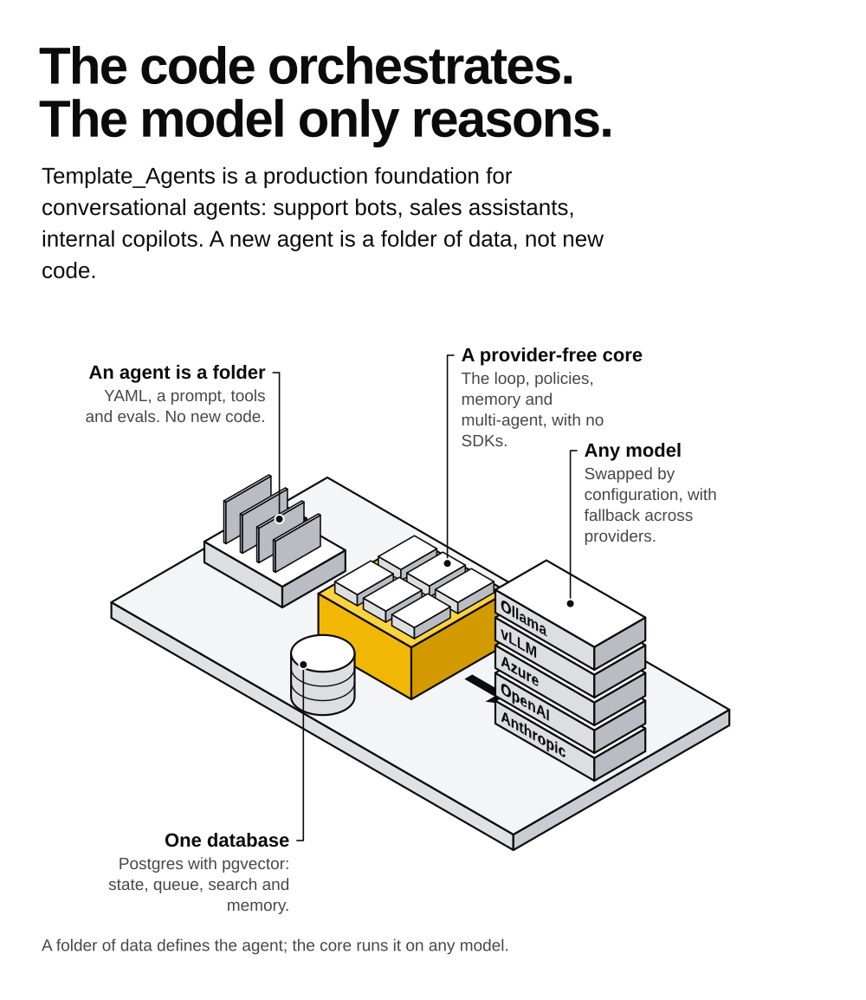</picture>

<picture><source media="(max-width: 640px)" srcset="assets/m/agents-2-en.svg"></picture>

<a href="https://wavesbyling.com"><picture><source media="(max-width: 640px)" srcset="assets/m/wavesling-1-en.svg">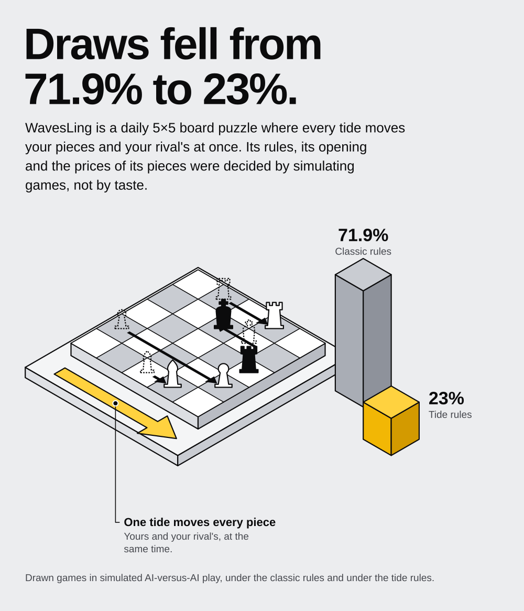</picture></a>

<a href="https://wavesbyling.com"><picture><source media="(max-width: 640px)" srcset="assets/m/wavesling-2-en.svg"></picture></a>

<a href="https://www.linkedin.com/in/brunomonrealpujol"><picture><source media="(max-width: 640px)" srcset="assets/m/back-en.svg"></picture></a>
